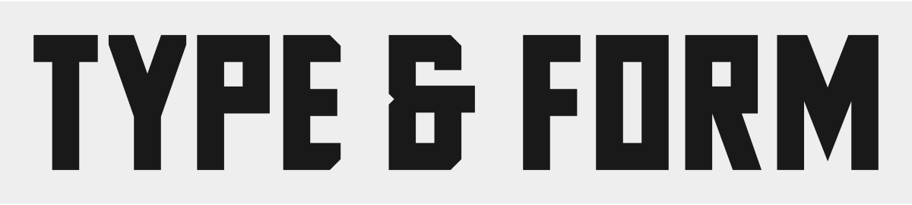

# Shalymenov Block

A compact, angular display family by **Alexander Shalymenov (Шалыменов)**. Light 300,
Regular 400, Bold 700 and ExtraBold 800. SIL Open Font License 1.1, with no
Reserved Font Names. Current version: **1.102**.



Submitted to Google Fonts for review: [Add Shalymenov Block #11201](https://github.com/google/fonts/issues/11201).
The family has not been accepted or published in the Google Fonts catalogue.

## Files

- `sources/`: four editable UFO masters, with complete OpenType feature sources.
- `fonts/ttf/`: TTF files, license, coverage, specimen and draft Google Fonts metadata.
- `fonts/webfonts/`: WOFF2 files and their CSS stylesheet.
- `tools/build.py`: reproducible fontmake build; no historical font binaries required.
- `documentation/`: concise technical status and requested Google Fonts subset coverage.
- `catalog/designers/alexandershalymenov/`: author biography and supplied portrait,
  prepared for Google Fonts onboarding; not yet registered in their catalogue.

## Designer


Alexander Shalymenov is a UX/UI designer and independent researcher based in Toronto, Canada. He works across digital product design and typography, and is the creator of Shalymenov Block, a compact geometric display typeface.

[Portfolio](https://selfolio.com/alex) · [Designer profile](catalog/designers/alexandershalymenov/)

## Build

Use Python 3.11 and an isolated environment:

```sh
python -m venv .venv
# Activate the environment for your operating system.
python -m pip install -r requirements.txt
bash sources/build.sh
# Or, without Bash:
python tools/build.py --sources sources --output build/ttf --web-output build/webfonts
python -m fontbakery check-googlefonts "fonts/ttf/*.ttf" --json build/fontbakery.json
```

The masters are independent static designs, not compatible variable-font masters.
The fixed build timestamp is 2026-10-30 UTC. The build enables TrueType smart
dropout and uses unhinted outlines; it is not a pixel-font or a 6px text font.

## Use on the web

Copy the contents of `fonts/webfonts/` together. Load the stylesheet,
then use `font-family: "Shalymenov Block", sans-serif` and weights 300/400/700/800.
Adjust `line-height` for the text; stacked accents may need more leading.

## Specimen website

The interactive specimen is maintained separately on the author's hosting
checkout. Its planned address is `https://mediadesign.ca/fonts/shalymenov-block/`;
hosting deployment is pending. The personal HTML/CSS/JavaScript page is not
included in the current font distribution. The static specimen above previews
the font directly from its outlines.

## Google Fonts status

Submitted on 30 October 2026: [google/fonts#11201](https://github.com/google/fonts/issues/11201).
The individual Google CLA has been submitted; association with this GitHub account
is subject to Google's verification. Editorial review, the family name, designer
profile, subset coverage and the documented warnings remain open intake items.
FontBakery is a technical preflight, not catalogue approval. No publication date
is promised.

AI assistance (OpenAI Codex) was used extensively in programmatic glyph
construction, font engineering, scripts, validation and documentation, with
iterative design direction and review by Alexander Shalymenov.
